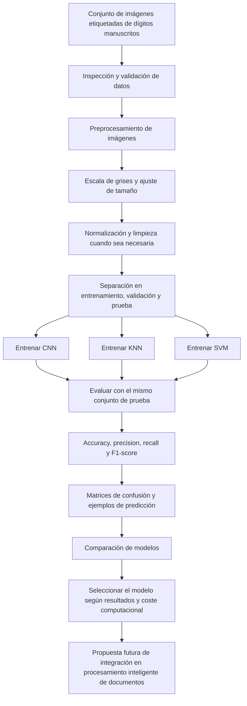

# Diagrama de la solución propuesta

El siguiente diagrama representa el flujo previsto para el proyecto. Es una propuesta de diseño; no indica que los modelos ya estén implementados ni entrenados.

## Descripción del flujo

1. **Datos:** se parte de imágenes de dígitos con etiquetas conocidas.
2. **Preparación:** se revisan las imágenes y se aplica el preprocesamiento apropiado.
3. **Entrenamiento:** se entrenan CNN, KNN y SVM con los datos de entrenamiento.
4. **Evaluación:** se calculan las métricas sobre el conjunto de prueba, que debe mantenerse separado del entrenamiento.
5. **Comparación:** se revisan las métricas y las confusiones entre dígitos.
6. **Selección:** se propone el modelo más adecuado según la evidencia obtenida.
7. **Aplicación futura:** el modelo seleccionado podría evaluarse como componente de un sistema de procesamiento de documentos. Esta integración queda fuera del avance teórico.

**Importante:** no se incluyen cifras de rendimiento porque los modelos todavía no han sido ejecutados.
